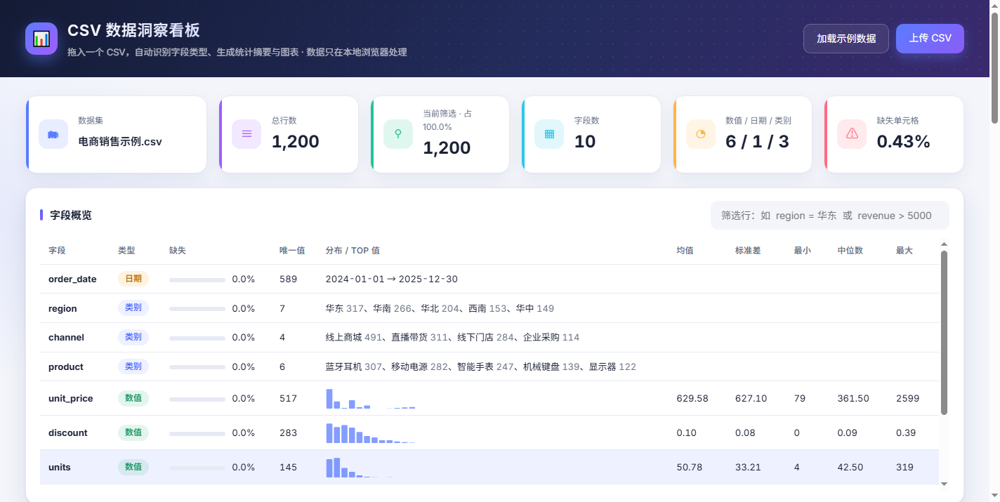
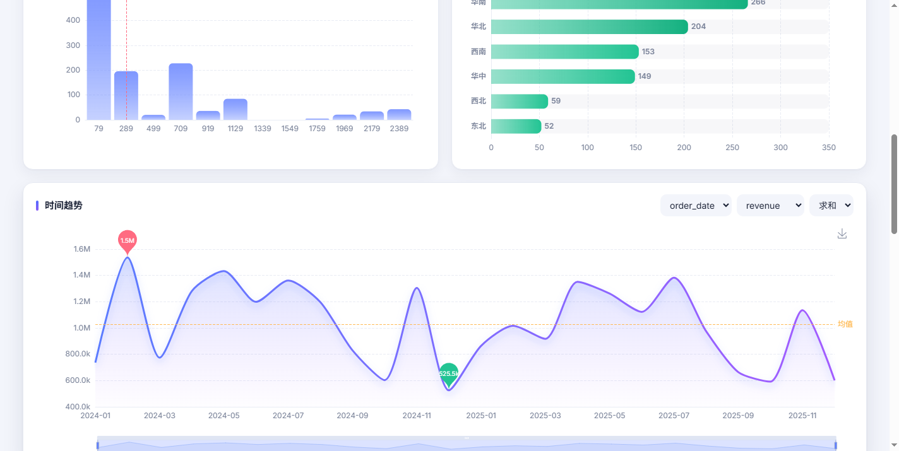
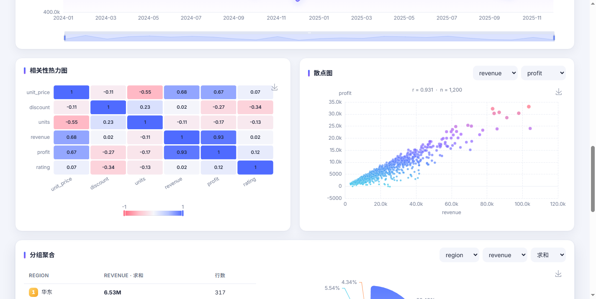
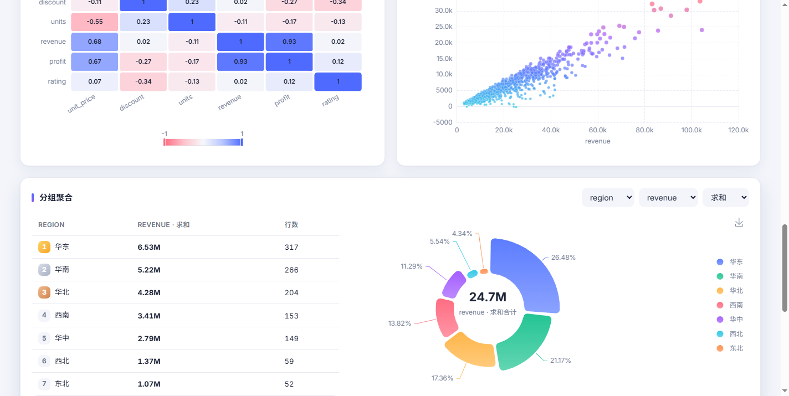
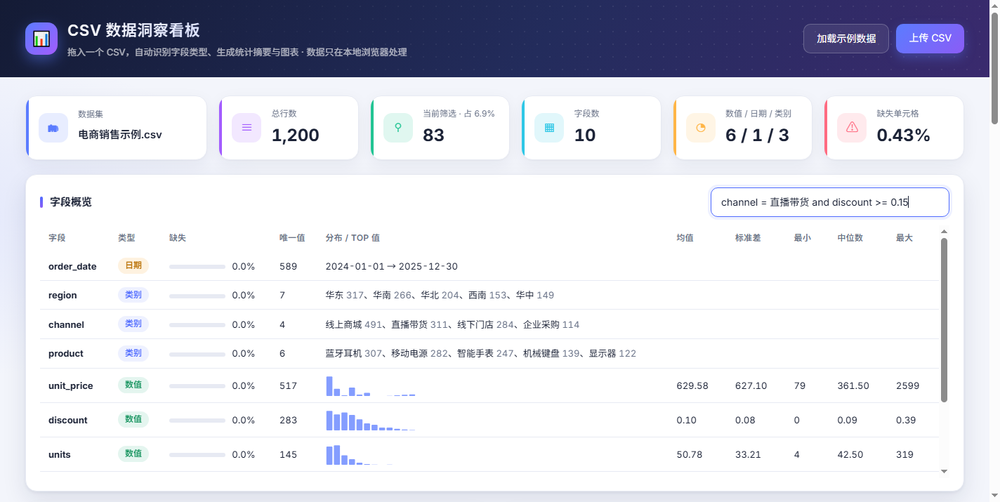

# CSV 数据洞察看板

拖入一个 CSV 文件，自动完成字段画像、统计摘要和可视化分析的纯前端工具。数据只在本地浏览器处理，不上传服务器。



## 功能

- **自动字段画像**：识别数值 / 日期 / 类别三种类型；统计缺失率、唯一值、均值、标准差、分位数；每个数值字段附迷你分布图，类别字段列出 Top 值
- **筛选表达式**：`region = 华东 and revenue > 3000`，支持 `= != > >= < <= ~(包含)`，多条件用 `and` 连接，所有图表实时联动
- **六类图表**：数值分布直方图、类别 Top 10、时间趋势（自动按日/月聚合，可缩放）、皮尔逊相关性热力图、散点图（默认展示相关性最强的一对字段）、分组聚合柱状图
- **分组聚合**：任选类别字段 group by，对数值字段求和 / 均值 / 计数 / 最大 / 最小
- **导出**：每张图可导出 PNG；筛选结果可导出 CSV（UTF-8 BOM，Excel 直接打开不乱码）
- **内置示例数据**：固定随机种子生成 1,200 行模拟电商销售明细，带有真实的相关结构（单价↑销量↓、折扣↑评分↓、季节性与双 11 峰值）

## 截图

| 时间趋势 | 相关性与散点 |
| --- | --- |
|  |  |
| **分组聚合** | **筛选联动** |
|  |  |

## 运行

无需构建，任意静态服务器即可：

```bash
python -m http.server 8899
# 打开 http://127.0.0.1:8899/
```

## 技术栈

原生 JavaScript（无框架、无打包）· [PapaParse](https://www.papaparse.com/) 解析 CSV · [Apache ECharts](https://echarts.apache.org/) 绘图 · CSS 变量实现亮 / 暗色主题与移动端自适应

## 设计参考

功能设计参考了 [kaggle-look-alike](https://github.com/evoluteur/kaggle-look-alike)（逐列字段画像）与 [hippotable](https://github.com/thoughtspile/hippotable)（浏览器内筛选、聚合与导出）的思路，代码为独立实现。
